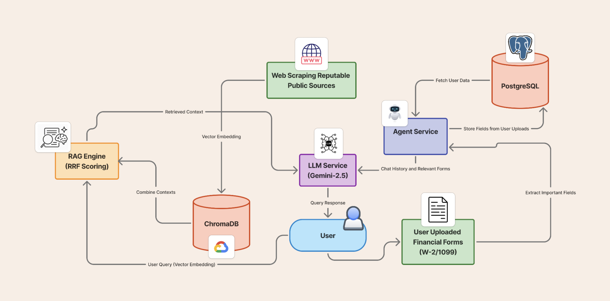

# Milestone 4: Development and Deployment

## 1. Solution Architecture

### 1.1 Overview

FinWhiz is a RAG-powered financial education platform that delivers both general knowledge (via vector database) and personalized guidance (via document analysis). The system uses a microservices architecture with containerized deployment.

### 1.2 System Architecture



#### 1.2.1 Architectural Layers

**Presentation Layer:** The frontend is a React 18 single-page application built with TypeScript and styled using Tailwind CSS. It runs on port 3000 and provides three primary interfaces: an onboarding wizard that collects user demographic and risk tolerance data, a chat interface for conversational queries, and a document upload module supporting W-2s, 1099s, and portfolio statements. The application maintains session state in browser localStorage and communicates with backend services exclusively through RESTful APIs.

**Reverse Proxy Layer:** Nginx serves as the API gateway, routing requests from the frontend to the appropriate backend microservices. It handles `/api/agent/*` requests by proxying them to the Agent Service on port 8010, and `/api/llm/*` requests to the LLM Service on port 8001. This abstraction provides a single entry point for the frontend, simplifies CORS configuration, enables future load balancing, and allows for SSL termination in production deployments.

**Application Layer:** Two FastAPI-based microservices comprise the core business logic:

- **Agent Service (Port 8010):** Manages the entire user session lifecycle including creation, message logging, and context retrieval. It handles all document upload operations by flattening PDFs using pdftk to remove encryption barriers, uploading raw files to Google Cloud Storage, and invoking Gemini Vision API to extract structured fields (employer names, wages, account numbers, etc.). Extracted data is persisted to Cloud SQL and made available through a context API that the LLM Service queries to personalize responses.

- **LLM Service (Port 8001):** Orchestrates the RAG pipeline by embedding incoming queries using Jina Embeddings v3, performing k-nearest neighbor searches against ChromaDB to retrieve relevant financial documents, fetching session-specific context from the Agent Service, merging all context sources, and forwarding the enriched prompt to Vertex AI's Gemini 2.5 Pro model. Responses include both the generated answer and source citations for transparency.

**Data Layer:** The data tier consists of three primary storage systems:

- **Cloud SQL (PostgreSQL 16):** Hosts relational data with a normalized schema covering users, sessions, messages, documents, and extracted field tables (w2_fields, form1099_fields, portfolio_fields). Foreign key constraints maintain referential integrity across the session hierarchy.

- **ChromaDB:** Provides vector similarity search capabilities using embeddings of chunked financial documents. The database is persisted locally within the LLM Service container and synchronized with GCS backups to enable restoration on container restart.

- **Google Cloud Storage:** Serves multiple purposes including user-uploaded document storage in the `fw_user_uploads` bucket, ChromaDB backups in the `fw_ws` bucket, and DVC remote storage for versioned datasets in `finwhiz-storage`.

**External Services Layer:** Google Vertex AI provides LLM inference through Gemini 2.5 Pro for production queries and Gemini 2.5 Flash Lite for the fine-tuned endpoint. The platform also uses Gemini's vision capabilities for document field extraction and Jina AI's embedding API for vector generation.

#### 1.2.2 Service Communication Patterns

**Synchronous Communication:** The frontend communicates with backend services using HTTP/REST with JSON payloads. The LLM Service makes blocking HTTP calls to the Agent Service's `/sessions/{id}/context` endpoint to retrieve user-specific data during query processing. All synchronous calls implement timeout configurations and retry logic for transient failures.

**Asynchronous Processing:** Document processing in the Agent Service occurs asynchronously after upload acknowledgment. The service returns a 202 Accepted response immediately, then processes the PDF flattening and field extraction in the background, updating the database upon completion. This prevents user-facing timeouts during lengthy extraction operations.

**Data Persistence Patterns:** Services follow an event-sourcing inspired approach for chat messages, storing each user and assistant message as an immutable record with timestamps. Document uploads create both a metadata record in Cloud SQL and a physical file in GCS, with the database entry containing the GCS path as a reference.

### 1.3 Data Flow

**General Query Flow:**

1. User asks question in chat → Frontend → LLM Service
2. LLM Service embeds query (Jina v3) → retrieves top-k docs from ChromaDB
3. Fetches session context from Agent Service
4. Sends combined context to Vertex AI (Gemini 2.5 Pro)
5. Returns answer + source citations

**Document Upload Flow:**

1. User uploads W-2/1099/Portfolio → Frontend → Agent Service
2. Agent flattens PDF (pdftk), uploads to GCS
3. Extracts fields via Gemini Vision API
4. Stores metadata in Cloud SQL
5. Available in session context for future queries

### 1.4 Component Responsibilities

| Component | Responsibilities |
|-----------|-----------------|
| **Frontend** | React UI, session management, localStorage persistence |
| **Nginx** | Reverse proxy, API routing, static file serving |
| **Agent Service** | Session/message CRUD, document processing, context API |
| **LLM Service** | RAG retrieval, embedding generation, LLM orchestration |
| **Cloud SQL** | User sessions, chat history, document metadata |
| **ChromaDB** | Vector similarity search for financial documents |
| **GCS** | User uploads, Chroma backups, DVC remotes |

## 2. Technical Architecture

### 2.1 Technology Stack

**Frontend:**
- React 18 + TypeScript + Vite
- Tailwind CSS
- Nginx (production server)
- Multi-stage Docker build

**Backend:**
- FastAPI (Python 3.12)
- SQLAlchemy 2.0 + psycopg3
- ChromaDB (vector database)
- Jina Embeddings v3
- Vertex AI (Gemini 2.5 Pro/Flash Lite)
- pdftk (PDF processing)

**Infrastructure:**
- Docker + Docker Compose
- Cloud SQL (PostgreSQL 16)
- Google Cloud Storage
- GitHub Actions (CI/CD)
- DVC (data versioning)

### 2.2 Design Patterns

**Microservices Architecture:**
- Agent and LLM services are independently deployable
- Clear service boundaries and single responsibilities
- Fault isolation

**API Gateway:**
- Nginx routes `/api/agent/*` and `/api/llm/*` to respective services
- Single entry point simplifies CORS and future load balancing

### 2.3 Database Schema

The database uses a hierarchical structure where users have multiple sessions, and each session contains related messages, documents, and extracted field data. The sessions table serves as the central entity with one-to-many relationships to messages (storing chat conversation history with role and content), documents (tracking uploaded files with type and GCS paths), w2_fields (containing employer information, wages, and tax withholdings), form1099_fields (storing payer details and interest income), and portfolio_fields (holding account values and asset allocation data). All tables use UUID primary keys and foreign key constraints to maintain referential integrity.

### 2.4 API Design

**Agent Service (Port 8010):**

| Endpoint | Method | Purpose |
|----------|--------|---------|
| `/health` | GET | Health check |
| `/sessions/` | POST | Create session |
| `/sessions/{id}/messages` | POST | Log message |
| `/sessions/{id}/w2` | POST | Upload W-2 |
| `/sessions/{id}/1099` | POST | Upload 1099 |
| `/sessions/{id}/portfolio` | POST | Upload portfolio |
| `/sessions/{id}/context` | GET | Get session context |

**LLM Service (Port 8001):**

| Endpoint | Method | Purpose |
|----------|--------|---------|
| `/health` | GET | Health check |
| `/query` | POST | RAG query with session context |

### 2.5 Code Organization

The repository follows a monorepo structure with the `src/` directory containing all microservices (frontend, agentic_user_data_processing, llm, embedder, webscraping, query_client, synthetic_data, and gcp_storage). Each service maintains its own Dockerfile, dependency management files, and test suite. The top-level `tests/` directory houses integration, cloud, and system tests that verify cross-service functionality. CI/CD pipelines are defined in `.github/workflows/`, while milestone documentation resides in `reports/milestone4/`. Configuration files including docker-compose.yml, .pre-commit-config.yaml, and pytest.ini are maintained at the repository root.

**Principles:**
- Service independence (own Dockerfile, pyproject.toml, tests)
- Separation of concerns (routes → services → repositories)
- Test co-location (unit tests with source)
- Configuration as code (Docker, CI/CD, linters versioned)

## 3. Continuous Integration & Testing

### 3.1 CI Pipeline

The CI/CD pipeline triggers on every push or pull request to relevant paths. It begins with parallel execution of linting (Black and Flake8 via pre-commit) and unit tests (using Python 3.12 and pytest). Upon successful completion of both jobs, integration tests execute to verify cross-service interactions with mocked external dependencies. Finally, cloud tests run conditionally if GitHub Secrets are configured, connecting to real Cloud SQL, GCS, and Vertex AI resources using Cloud SQL Proxy for database connectivity.

### 3.2 Test Structure

**Unit Tests** (`src/{service}/tests/`):
- Individual functions/classes
- Mocked external APIs (Vertex AI, GCS)
- In-memory SQLite for database tests

**Integration Tests** (`tests/integration/`):
- Cross-service interactions
- Mocked external dependencies

**Cloud Tests** (`tests/cloud/`):
- Real Cloud SQL, GCS, Vertex AI
- Runs only if GitHub Secrets configured
- Uses Cloud SQL Proxy

**Coverage Target:** 50%+

### 3.3 Code Quality

**Tools:**
- Black (formatter)
- Flake8 (linter)
- pre-commit hooks

**Local execution:**
```bash
pre-commit run --all-files
```

**CI execution:**
- Runs on every push/PR
- Enforces code style consistency
